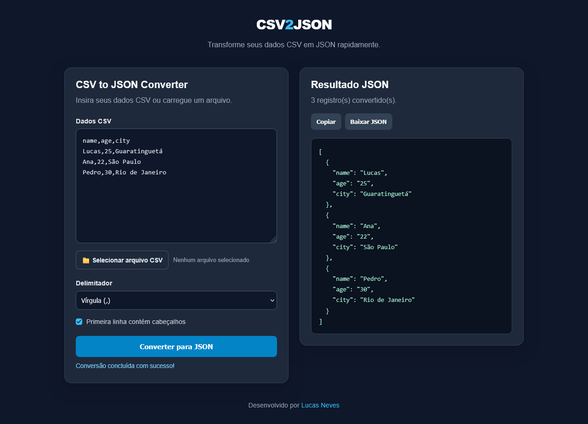

# CSV2JSON App

A simple and responsive web application that converts CSV (Comma-Separated Values) data into JSON (JavaScript Object Notation). Built with HTML, CSS, and vanilla JavaScript, this tool allows users to paste CSV content or upload a CSV file and convert it into structured JSON data.

## Features

- **CSV to JSON Conversion:** Convert CSV data into JSON objects.
- **File Upload:** Import CSV files directly from your computer.
- **Custom Delimiters:** Support for commas, semicolons, and tabs.
- **Header Detection:** Use the first row as object keys or generate column names automatically.
- **Formatted JSON Output:** Display JSON with indentation for better readability.
- **Copy to Clipboard:** Copy the converted JSON with one click.
- **Download JSON:** Save the result as a `.json` file.
- **Error Handling:** Display informative messages when invalid data is provided.
- **Responsive Design:** Works on desktop and mobile devices.
- **No Dependencies:** Built with vanilla JavaScript without external libraries.

## Technologies Used

- HTML5
- CSS3
- JavaScript (Vanilla JS)
- File API
- Clipboard API
- Blob API

## Project Structure

```text
CSV2JSON/
├── index.html
├── css/
│   └── styles.css
├── js/
│   └── script.js
└── README.md
```

## Getting Started

### Prerequisites

You only need a modern web browser to run this application.

### Installation

1. Clone the repository:

   ```bash
   git clone https://github.com/Taunt-byte/CSV2JSON.git
   ```

2. Navigate to the project directory:

   ```bash
   cd CSV2JSON
   ```

3. Open `index.html` in your browser.

No additional dependencies or build tools are required.

## How to Use

1. Paste your CSV data into the input area or upload a `.csv` file.
2. Select the appropriate delimiter: comma, semicolon, or tab.
3. Choose whether the first row contains column headers.
4. Click **Convert to JSON**.
5. Review the formatted JSON output.
6. Click **Copy** to copy the result or **Download JSON** to save it as a file.

## Example

### Input (CSV)

```csv
name,age,city
Lucas,25,Sao Paulo
Ana,22,Rio de Janeiro
Pedro,30,Belo Horizonte
```

### Output (JSON)

```json
[
  {
    "name": "Lucas",
    "age": "25",
    "city": "Sao Paulo"
  },
  {
    "name": "Ana",
    "age": "22",
    "city": "Rio de Janeiro"
  },
  {
    "name": "Pedro",
    "age": "30",
    "city": "Belo Horizonte"
  }
]
```

**Note:** CSV values are preserved as strings. The application does not automatically convert numeric-looking values into numbers.

## Learning Objectives

This project helps practice:

- DOM manipulation and event handling.
- Arrays, objects, and string processing.
- JSON serialization with `JSON.stringify()`.
- Reading local files with the File API.
- Copying data with the Clipboard API.
- Generating downloadable files with Blob and object URLs.
- Input validation and error handling.
- Parsing CSV fields, including quoted values.

## Future Improvements

- Automatically detect the CSV delimiter.
- Support additional character encodings.
- Add JSON-to-CSV conversion.
- Provide a table preview of the imported CSV data.
- Allow users to configure output formatting.
- Add automated tests for CSV parsing and conversion.
- Improve support for edge cases in CSV formatting.

## Screenshot



## Author

**Lucas Neves**

- GitHub: [@Taunt-byte](https://github.com/Taunt-byte)

## License

This project is intended for educational and portfolio purposes. Add a `LICENSE` file to specify the terms under which others may use, modify, and distribute the project.
